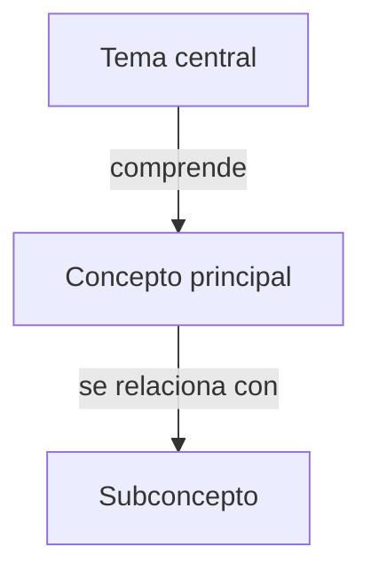

# Ejemplo 01 — Análisis individual básico (Markdown)

## Caso de uso

Un estudiante universitario sube **una sola lectura en PDF** y pide una guía de estudio rápida y un podcast corto, en formato Markdown.

## Entrada del usuario

> "Adjunto el capítulo 3 de mi libro de epistemología. Hazme una guía de estudio
> y un podcast educativo breve. Con modo individual y profundidad básica."

## Configuración resultante

El skill fusiona la petición con los valores por defecto:

```json
{
  "processing": {
    "mode": "individual",
    "analysis_depth": "basic"
  },
  "output": {
    "format": "md",
    "generate_zip": true,
    "zip_name": "material_estudio.zip",
    "include_manifest": true
  },
  "podcast": {
    "enabled": true,
    "target_duration_minutes": 10,
    "speakers": 2
  },
  "questions": {
    "enabled": true,
    "count": 10,
    "difficulty": "basic"
  }
}
```

## Estructura del ZIP generado

```
material_estudio.zip
│
├── individual/
│   └── capitulo_03_epistemologia/
│       ├── capitulo_03_epistemologia_guia_estudio.md
│       └── capitulo_03_epistemologia_podcast.md
│
└── manifest.json
```

## Contenido esperado de `capitulo_03_epistemologia_guia_estudio.md`

```markdown
# Guía de estudio — Capítulo 3: [Título]

## Sección 1. Resumen general

### 1.1. Presentación del documento
...
### 1.2. Tema central
...
### 1.3. Propósito del autor
...
### 1.4. Desarrollo de las ideas principales
...
### 1.5. Conceptos fundamentales
...
### 1.6. Aportes relevantes
...
### 1.7. Conclusiones generales
...
### 1.8. Síntesis para recordar
...

## Sección 2. Aspectos importantes por capítulo o sección

### Capítulo 3 — [Nombre original]

#### 2.3.1. Descripción general
...
#### 2.3.9. Conceptos clave para estudiar
1. ...
2. ...
3. ...
4. ...
5. ...

## Sección 3. Mapa conceptual



## Sección 5. Preguntas de estudio con respuestas

**Pregunta 1 — Conceptual**
...
```

## Notas de ejecución

- Profundidad `basic` → síntesis centrada en lo esencial; no se agotan matices.
- Preguntas `basic` → identificación y comprensión.
- Podcast de 10 min → ~1 200–1 500 palabras.