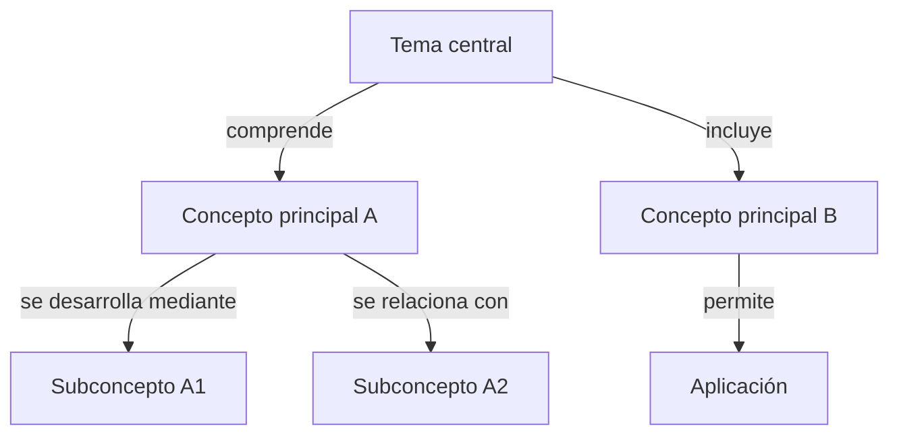

# Modalidad A — Análisis individual

Se ejecuta cuando `processing.mode` es `individual` o `both`. Cada documento se analiza de manera independiente.

Por documento se generan **dos archivos** (si las funcionalidades están habilitadas):

- `<nombre_documento>_guia_estudio.<formato>` (Archivo A1)
- `<nombre_documento>_podcast.<formato>` (Archivo A2)

---

## ARCHIVO A1 — GUÍA DE ESTUDIO

Contenido: Secciones 1, 2, 3 y 5. La sección 4 se reserva para el podcast.

### SECCIÓN 1. RESUMEN GENERAL

Estructura:

- **1.1. Presentación del documento** — título, autor, contexto.
- **1.2. Tema central** — tema principal y por qué es relevante.
- **1.3. Propósito del autor** — objetivo y problemas que aborda.
- **1.4. Desarrollo de las ideas principales** — síntesis narrativa que conecte ideas.
- **1.5. Conceptos fundamentales** — definiciones comprensibles; conservar terminología y explicar términos complejos.
- **1.6. Aportes relevantes** — planteamientos, modelos, resultados o reflexiones clave.
- **1.7. Conclusiones generales** — distinguir conclusiones del autor de interpretaciones propias.
- **1.8. Síntesis para recordar** — aprendizajes fundamentales.

### SECCIÓN 2. ASPECTOS IMPORTANTES POR CAPÍTULO O SECCIÓN

Sigue la estructura original. No omitas capítulos sustantivos. Si no hay capítulos formales, usar secciones temáticas.

Estructura por capítulo:

- **2.X.1. Descripción general**
- **2.X.2. Tema principal**
- **2.X.3. Conceptos fundamentales**
- **2.X.4. Ideas principales** — qué plantean, relevancia, relaciones.
- **2.X.5. Argumentos y aportes relevantes** — teorías, modelos, métodos, resultados; con evidencias.
- **2.X.6. Ejemplos y aplicaciones** — del autor; los propios marcados como "ejemplo explicativo".
- **2.X.7. Relaciones con otros capítulos**
- **2.X.8. Conclusión del capítulo**
- **2.X.9. Conceptos clave para estudiar** — exactamente `key_concepts_per_chapter` si existen.
- **2.X.10. Referencias** — páginas o secciones que sustentan los hallazgos.

### SECCIÓN 3. MAPA CONCEPTUAL

Elementos: tema central, conceptos principales, conceptos secundarios, relaciones jerárquicas, relaciones transversales, procesos y consecuencias, aplicaciones.

**Formato Mermaid (`flowchart`):**



Requisitos: etiquetas breves, relaciones significativas, respetar `max_depth`, evitar saturación.

**Explicación posterior:** concepto central, relaciones principales, conexiones entre capítulos, conclusiones derivadas.

### SECCIÓN 5. PREGUNTAS DE ESTUDIO CON RESPUESTAS

Generar exactamente `questions.count` preguntas, sin repetición artificial.

Distribución recomendada (10 preguntas, mixed):
- 2 conceptuales
- 2 de comprensión
- 2 analíticas
- 2 de relación
- 2 de aplicación

**Formato obligatorio de cada pregunta:**

```
**Pregunta N — [Categoría]**

**Pregunta:**
[Enunciado]

**Respuesta:**
[Respuesta clara y completa]

**Explicación:**
[Justificación y relación con los conceptos]

**Referencia:**
[Capítulo, sección o página]
```

---

## ARCHIVO A2 — GUION DE PODCAST INDIVIDUAL

Nombre: `<nombre_documento>_podcast.<formato>`. Contiene exclusivamente la Sección 4 + datos de identificación.

### SECCIÓN 4. RESUMEN DE IDEAS PRINCIPALES ESTILO PODCAST

**Participantes:**
- `speakers = 1` → **Narrador** (exposición educativa conversacional).
- `speakers = 2` → **Presentador** + **Experto**.

**Estructura del episodio:**

- **A. Introducción** — bienvenida, tema, lectura, importancia, qué aprenderá el oyente.
- **B. Contextualización** — propósito del documento y su relación con el tema.
- **C. Desarrollo de ideas principales** — en bloques temáticos: introducir → explicar → características → conectar → ejemplos → enseñanza.
- **D. Análisis y reflexión** — implicaciones académicas/prácticas sustentadas.
- **E. Recapitulación** — conceptos esenciales.
- **F. Cierre** — síntesis y reflexión de aprendizaje.

**Duración aproximada (120–150 palabras/min):**

| Duración | Palabras |
|---|---|
| 10 min | 1 200 – 1 500 |
| 12 min | 1 440 – 1 800 |
| 15 min | 1 800 – 2 250 |
| 20 min | 2 400 – 3 000 |
| 25 min | 3 000 – 3 750 |
| 30 min | 3 600 – 4 500 |

**Entregable:** título del episodio, documento de origen, duración estimada, participantes, guion completo, recapitulación final.